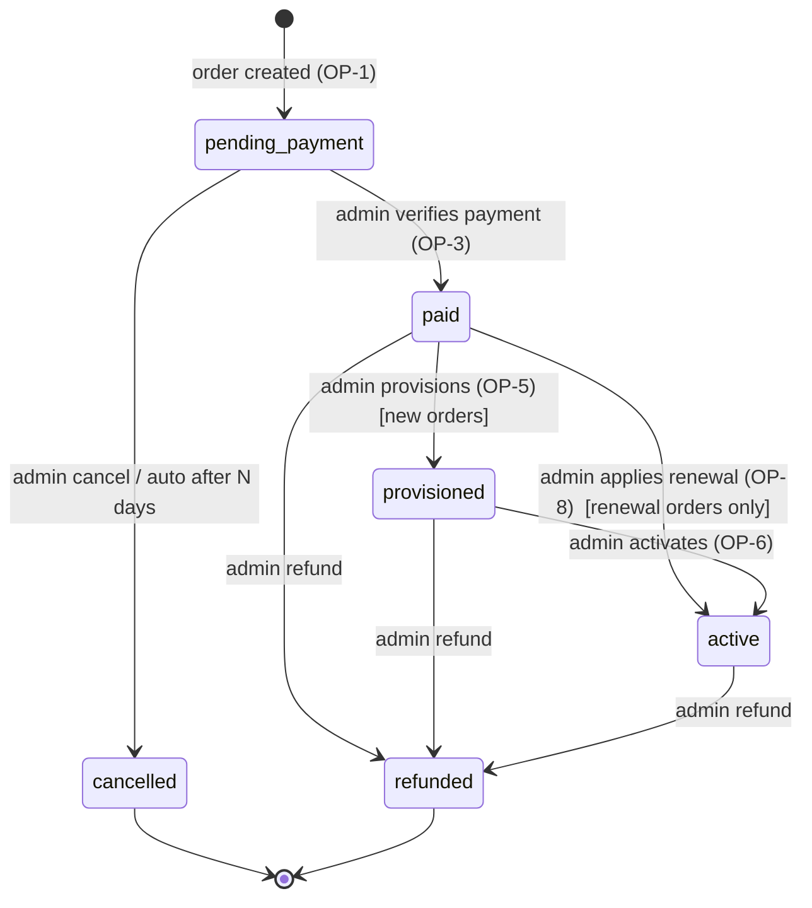
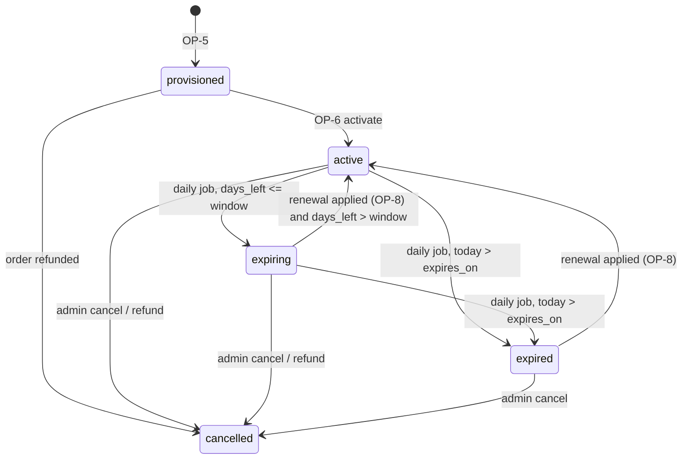

# 02_AppFlow — Screens, Routes, State Machines

Related: [01_PRD](01_PRD.md) · [03_UI_Spec](03_UI_Spec.md) · [04_TRD §9](04_TRD.md) (API) · [05_Schema](05_Schema.md) · [06_Plan](06_Plan.md)
Notation: **[btn]** = button, `GET /x` = API call from [04_TRD §9], (S) = screen state.

## 1. Routes, language and global behaviour

### 1.1 Public routes (Bangla default, English under `/en`)
| Screen | Bangla route | English route | Rendering |
|---|---|---|---|
| Home | `/` | `/en/` | static + PricingGrid island |
| Web Hosting | `/web-hosting` | `/en/web-hosting` | static |
| Pricing | `/pricing` | `/en/pricing` | static + PricingGrid island |
| About | `/about` | `/en/about` | static |
| Contact | `/contact` | `/en/contact` | static + ContactForm island |
| FAQ | `/faq` | `/en/faq` | static |
| Terms of Service | `/terms` | `/en/terms` | static (Markdown) |
| Privacy Policy | `/privacy` | `/en/privacy` | static (Markdown) |
| Refund Policy | `/refund-policy` | `/en/refund-policy` | static (Markdown) |
| Order Form | `/order` (`?package=<slug>`) | `/en/order` | OrderForm island |
| Order Confirmation + Payment Instructions | `/order/payment` (`?o=<order_code>`) | `/en/order/payment` | PaymentForm island |
| Order Status | `/order/status` (`?o=<order_code>` optional prefill) | `/en/order/status` | StatusLookup island |
| Not found | `/404` | – | static, bilingual |

### 1.2 Admin routes (English only; behind Cloudflare Access; `noindex`)
`/admin` · `/admin/orders` · `/admin/orders/detail?id=` · `/admin/payments` · `/admin/services` · `/admin/services/detail?id=` · `/admin/renewals` · `/admin/customers` · `/admin/customers/detail?id=` · `/admin/messages` · `/admin/settings/packages` · `/admin/settings/payment` · `/admin/settings/templates` · `/admin/settings/general` · `/admin/export`.

### 1.3 Global rules
- **Language switch** ([btn] "EN"/"বাংলা" in header) goes to the same page in the other locale, preserving query string. No automatic redirect by browser language. `<html lang="bn|en">` is set per page; `hreflang` alternates are emitted.
- **Theme toggle** cycles `system → light → dark`, stored in `localStorage['hn-theme']` (wrapped in try/catch; page works without it) — rules in [03_UI_Spec §6].
- **Header**: logo, links (Home, Web Hosting, Pricing, FAQ, Contact), [Order now], language switch, theme toggle. Mobile: menu button opens a full-width panel (focus trapped, `Esc` closes).
- **Footer**: About, Terms, Privacy, Refund Policy, support WhatsApp/email (from public settings), `upstream_disclosure_*` text, © `business_name`.
- **Forms** (all): inline field errors under fields, error summary at top on submit (focus moves to it), submit button shows loading and is disabled while a request is in flight (prevents double submit), values are kept on error, Turnstile widget re-rendered after any failed submit.
- **Network**: if `fetch` fails (offline/timeout 15 s) show the Alert "Network problem — check your connection and try again" with [Try again]; nothing is lost from the form.
- **No-JS**: marketing pages are readable without JS. Pricing/forms show a `<noscript>` note with the WhatsApp link.

## 2. Public screens

### 2.1 Home
Sections in order: Hero (headline, one sentence, [Order hosting] → `/order`, [See pricing] → `/pricing`) → "How ordering works" (4 steps: choose package → place order → pay via bKash/Nagad/bank and send the transaction ID → we verify and set up your hosting, then send your login details privately) → PricingGrid (published packages) → FAQ teaser (first 3 FAQ items) → Contact strip (WhatsApp [btn], [Contact page]).
PricingGrid states: (S) loading = 3 skeleton cards · (S) loaded · (S) empty (`packages=[]`) "Packages are being updated. Message us on WhatsApp for the current offer." + [WhatsApp] · (S) error "Could not load packages" + [Try again] + [WhatsApp].
Content rules: no stats, no reviews, no uptime, no "best/fastest" claims ([03_UI_Spec §1 R1–R4]).

### 2.2 Web Hosting
Static explanation of the product: shared web hosting, what a package contains is shown from the data (same PricingGrid in compact mode), how setup works, what we need from you (name, phone, domain if you already have one), that hosting infrastructure is provided by third-party upstream providers (`upstream_disclosure_*`). [Order hosting] → `/order`.

### 2.3 Pricing
PricingGrid full mode: for each published package a card: name, tagline, **৳{price_bdt} / year** (`term_months=12` → "year", else "{n} months"), feature rows (label: value, in the page language), [Choose {name}] → `/order?package={slug}`. Below: note "Prices in BDT. Limits are set by the package; see the Refund Policy before ordering." States as 2.1.

### 2.4 About, FAQ, Terms, Privacy, Refund
- **About**: who runs HOSTNEIL (text supplied by owner in `i18n`), what is resold, the upstream disclosure. No team photos/awards/customer counts unless the owner adds real text.
- **FAQ**: `
` accordions from `i18n` keys `faq.*` (code-managed, not DB). Required questions (answers written by owner/agent without numeric promises): how to order · how to pay · how do I know my payment was received · when/how do I get login details (privately via WhatsApp or email) · how renewal works · refund policy summary · who provides the hosting (upstream disclosure) · how to contact support.
- **Legal**: rendered from Markdown content collection; page shows "Last updated {date}" and `terms_version`. Draft banner in non-production builds only.
States: static; 404 for unknown slug.

### 2.5 Order flow

#### 2.5.1 Order Form `/order`
Fields: **Package** (select, required; preselected from `?package=` if it exists in published list; options come from `GET /api/public/packages`) · **Full name** (required) · **Mobile number** (required, BD) · **Email** (optional) · **Domain** (optional, "if you already have one") · **Note** (optional, 300 chars, with warning R6 "Never write passwords here") · **Contact language** (radio bn/en, default current language) · **Consent checkbox** "I have read the Terms of Service and Refund Policy" (links open in new tab) · hidden honeypot `website` · Turnstile.
Order summary box updates live: package, ৳ total, term.
[Place order] → `POST /api/public/orders`.
| (S) | Behaviour |
|---|---|
| idle | submit enabled once required fields non-empty |
| validating | inline errors on blur/submit |
| submitting | button loading, fields disabled |
| success `201` | store `{order_code,total_bdt,package_name,contact}` in `sessionStorage['hn-order']`; go to `/order/payment?o={order_code}` |
| `VALIDATION_FAILED` | map `fields` to inline errors |
| `PACKAGE_UNAVAILABLE` | Alert "This package is no longer available" + reload package list |
| `DUPLICATE_PENDING_ORDER` | Alert "You already have an unpaid order for this package. Check your WhatsApp/email, check status, or contact us." + links to `/order/status` and WhatsApp |
| `CAPTCHA_FAILED` / `CAPTCHA_UNAVAILABLE` | reset widget, message "Verification failed. Try again." |
| `RATE_LIMITED` | "Too many attempts. Try again in {Retry-After} minutes." |
| packages list empty/error | form disabled with the 2.1 empty/error message |

#### 2.5.2 Order Confirmation + Payment Instructions `/order/payment?o=`
1. **Confirmation block**: "Order received" · Order ID `HN-XXXXXXXX` with [Copy] · package · total ৳ · status "Waiting for your payment" · note "Your order is not active until we verify your payment." If an email was given: "We sent a confirmation to {email}" (only if the API reported it queued).
2. **Payment instructions** (data from `GET /api/public/settings`): tabs **bKash | Nagad | Bank transfer**. bKash/Nagad tab: number, type (Personal/Merchant), steps ("Send Money/Payment to this number, amount exactly ৳{total}, reference = your Order ID if the app allows, keep the transaction ID"). Bank tab: bank, account name, number, branch. `payment_note_*` text appended. [Copy number] buttons. If a payment detail setting is empty its tab is hidden; if all empty → Alert "Payment details are not available yet. Message us on WhatsApp." (no form).
3. **"I have paid" form**: Method (radio, required) · Transaction ID (required) · Sender number/account (required) · Amount paid ৳ (prefilled with total, editable) · Turnstile → [Submit payment details] → `POST /api/public/orders/:code/payments` (contact taken from sessionStorage).
4. If `sessionStorage['hn-order']` is missing or its code ≠ `?o=`: show only a mini form "Enter the phone number or email you used for this order" (+Turnstile) — contact is held in memory for the submit; nothing is displayed about the order until a successful submit or a status lookup.
| (S) | Behaviour |
|---|---|
| success `201` | replace form with "Payment details received. We will verify the transaction ID and amount, then update your order. This can take some time; you can check status any time." + [Check order status] + [WhatsApp] |
| `DUPLICATE_TRX` | "This transaction ID was already submitted. Check the ID or contact us." |
| `ORDER_NOT_PAYABLE` | "This order is no longer waiting for payment." + [Check order status] |
| `NOT_FOUND_OR_MISMATCH` | "Order ID and contact do not match." + re-enter contact |
| other errors | as 1.3 / 5 |

#### 2.5.3 Rules
- Payment details shown only after an order exists; the page never states an order is paid.
- Unpaid orders auto-cancel after `pending_order_expiry_days` ([04_TRD §5]); the confirmation block states this period using that setting (not a hard-coded number).

### 2.6 Order Status `/order/status`
Form: Order ID (uppercase-normalised; accepts with/without `HN-`), Phone **or** email, Turnstile, [Check status] → `POST /api/public/orders/lookup`. `?o=` prefills Order ID; `sessionStorage['hn-order']` prefills contact.
Result card (S found):
- Header: Order ID, package, ৳ total, created date, **status badge** (display status, [§4.3]).
- **Progress stepper**: Pending payment → Paid → Provisioned → Active (current highlighted; cancelled/refunded replace the stepper with a single banner).
- **Payment** line: none / submitted (method, time) / verified / "could not be verified".
- **Service** block (only if service exists and status active/expiring/expired): domain, covered until `expires_on`, days left, status.
- **Next step text** per display status ([§4.3] table).
- Buttons: [Submit payment details] (when pending and payment state none/rejected) → `/order/payment?o=`; [Message us on WhatsApp] (prefilled "Hello, my order ID is HN-…"); [Check another order].
Never shown: credentials, ids, phone/email, internal notes.
| (S) | Behaviour |
|---|---|
| idle | empty form |
| loading | button loading; result area has skeleton |
| found | result card |
| `NOT_FOUND_OR_MISMATCH` | "We couldn't find an order with these details. Check the Order ID and the phone/email you used. Still stuck? Message us on WhatsApp." (identical for unknown ID and wrong contact) |
| `RATE_LIMITED` | "Too many attempts. Try again in {n} minutes." |
| `CAPTCHA_*` | reset widget + message |
| network | 1.3 network Alert |

### 2.7 Contact `/contact`
Top: [WhatsApp] (wa.me from `support_whatsapp_e164`; hidden if empty), support email (if set), support hours (if set). Form: name, phone or email (at least one), message (5–1500 chars), Turnstile, honeypot, [Send message] → `POST /api/public/contact`.
States: success "Message sent. We will reply on the phone/email you gave." · validation errors inline · rate-limited / captcha / network as above · if both WhatsApp and email are empty and the form fails: show nothing invented (just the error).

## 3. Admin Console

### 3.0 Shell
Sidebar (≥ 1024 px) / top bar + slide-out menu (mobile): Dashboard, Orders, Payments, Services, Renewals, Customers, Messages, Settings (Packages, Payment details, Message templates, General), Export. Top bar: global search box (order code, phone, domain → `/admin/orders?q=`), admin email, [Log out] (`/cdn-cgi/access/logout`).
Boot sequence on every admin page: `GET /api/admin/me` → 200 render; `401` → full-page reload (Access login); `403` → full-page "Your account is not authorised for HOSTNEIL Console" (no data). All admin fetches send `X-HN-Console: 1`. Mutating buttons always use a confirm dialog and show success toast / inline error with the API `message`.
Lists: 25 rows/page, server pagination (`page`), sorting fixed (newest first, or by `expires_on` ascending for services/renewals). Mobile: table rows become cards.

### 3.1 Dashboard `/admin`
Tiles (count → link): **Payments to verify** (`payments.status=submitted`) → `/admin/payments?status=submitted` · **Paid — set up hosting** (`orders.status=paid`) → `/admin/orders?status=paid` · **Provisioned — activate** → `/admin/orders?status=provisioned` · **Unpaid orders** (`pending_payment`) · **Expiring ≤ {window} days** → `/admin/services?status=expiring` · **Expired** → `/admin/services?status=expired` · **Reminders due** → `/admin/renewals` · **New messages** → `/admin/messages`.
Below tiles: "Needs attention" list (oldest-first merge of the first five items from payments-to-verify, paid-not-provisioned, provisioned-not-activated). Footer line: last daily-job run time (from `audit_log` `system`).
Empty: "Nothing needs your attention." States: loading skeleton tiles; error Alert + [Retry].

### 3.2 Orders `/admin/orders`
Filters: status (all/each), kind (new/renewal), search `q` (order code, phone, name, domain). Columns: Order ID, customer, package, ৳ total, status badge, created, age. Row → detail. Empty: "No orders match." / first-run "No orders yet. Orders from the website appear here."

### 3.3 Order detail `/admin/orders/detail?id=`
Panels: **Summary** (code, kind, package snapshot, total, term, domain, customer note, terms version, created) · **Customer** (name, [Call], [WhatsApp], email) · **Payments** (all rows with method, trx ID, sender, claimed ৳, status, times; [Verify]/[Reject] on `submitted` rows) · **Service** (if any) · **Timeline** (audit rows for the order) · **Actions** (below).
Action availability (button shown only when allowed; server re-checks):
| Order status | Buttons |
|---|---|
| `pending_payment` | [Verify] / [Reject] per submitted payment · [Cancel order] · [WhatsApp: payment instructions] |
| `paid` (kind new) | [Provision hosting] · [Refund] |
| `paid` (kind renewal) | [Apply renewal] · [Refund] |
| `provisioned` | [Activate service] · [Refund] |
| `active` | [Create renewal order] (if kind new and service exists) · [Refund] |
| `cancelled`, `refunded` | none (read-only banner) |

**Verify dialog**: shows method, trx ID, sender, claimed ৳, **order total ৳**. Admin must type **Verified amount (৳)** (field starts empty) and tick "I checked this transaction ID and amount in the bKash/Nagad/bank account." [Confirm payment] is enabled only when the typed amount equals the order total and the box is ticked. Server `AMOUNT_MISMATCH` → inline error. On success toast + prompt [Open WhatsApp: payment verified] (template `payment_verified`).
**Reject dialog**: reason (required, 300 chars). On success prompt [WhatsApp: payment rejected].
**Provision dialog**: upstream provider (required; datalist of previously used), upstream account/ref (optional), domain (prefilled). Banner: "Do not enter passwords here. Send login details to the customer privately (WhatsApp/email)."
**Activate dialog**: shows "Starts {today} · Covered until {expires_on}" computed with the rules in [05_Schema §3.8]; [Confirm activation]; then [Open WhatsApp: service activated].
**Cancel / Refund dialogs**: reason/note required; refund shows impact ("service will be cancelled").
Errors: `INVALID_TRANSITION` (stale page) → toast "Order changed meanwhile" + reload. States: loading skeleton; `NOT_FOUND` → "Order not found" + back link.

### 3.4 Payments `/admin/payments`
Tabs: Submitted (default) · Verified · Rejected. Row: Order ID, method, trx ID, sender, claimed ৳, order total ৳ (warning chip "amount differs" when unequal), age. [Review] → order detail with the verify dialog open. Empty: "No payments waiting for verification."

### 3.5 Services `/admin/services` and detail
List filters: status, search; sorted by `expires_on` asc. Columns: domain, customer, package, upstream, starts, expires, days left, status badge. Detail: all fields, edit form (domain, upstream provider/ref, admin note, expiry override with confirm), reminder history, linked orders, [Create renewal order]. Empty: "No services yet."

### 3.6 Renewals `/admin/renewals`
Tabs: **Due now** (reminders `pending` with `due_on ≤ today`, channel whatsapp; email ones shown read-only with "auto") · **Upcoming** (services expiring in next 30 days) · **Expired** (not renewed). Row: customer, domain, expires_on, days left, reminder offset.
Buttons per row: [WhatsApp] → `GET /api/admin/reminders/:id/whatsapp` → opens `https://wa.me/<phone>?text=<encoded template>` in a new tab (does **not** mark sent) · [Mark sent] → `mark-sent` · [Skip] (reason optional) · [Create renewal order]. Template language = customer's `preferred_lang`. Empty: "No reminders due today."

### 3.7 Customers `/admin/customers`, detail
List: name, phone, email, #orders, #active services. Detail: contact info, language, admin note (editable), orders, services. Empty states as above. No delete button.

### 3.8 Messages `/admin/messages`
List of contact messages (new first); open → mark read; [Archive]; [Reply on WhatsApp] / [Reply by email] links. Empty: "No messages."

### 3.9 Settings
- **Packages** `/admin/settings/packages`: list (name, price, published, sort). [New package] / edit form: slug (immutable after first order), names bn/en, taglines bn/en, price ৳, term (12 fixed in MVP UI), sort, **Features editor** (rows: label bn/en, value bn/en; add, remove, reorder), [Publish] toggle — blocked with `PACKAGE_INCOMPLETE` message when no feature rows. Preview shows how the card looks in bn and en. Warning when editing price of a package with unpaid orders ("existing orders keep their price").
- **Payment details** `/admin/settings/payment`: bKash/Nagad numbers + types, bank fields, `payment_note_*`.
- **Message templates** `/admin/settings/templates`: 4 keys × 2 languages; textarea with placeholder chips; live preview with sample data; save rejects unknown placeholders.
- **General** `/admin/settings/general`: business name, support WhatsApp (digits, 8801…), support email, hours, upstream disclosure texts, `terms_version`, thresholds (`expiring_window_days`, `reminder_offsets`, `pending_order_expiry_days`, `auto_email_reminders`, `owner_digest_enabled`).
All settings forms: validate with zod, [Save] disabled until changed, toast on success, audit row.

### 3.10 Export `/admin/export`
Buttons per table (orders, payments, services, customers, reminders) → `GET /api/admin/export/<table>.csv` download. Text: "Do this at least monthly and store the file securely. See backup steps." Shows last export date (from audit).

## 4. State machines

### 4.1 Order status machine (`orders.status`)

| From | To | Actor | Guard (all enforced in `lifecycle.ts`; key ones also by DB triggers) | Side effects |
|---|---|---|---|---|
| — | pending_payment | customer | package published, validation, Turnstile, rate limits | customer upsert, audit, confirmation + owner alert email |
| pending_payment | paid | **admin only** | one `submitted` payment, verified amount == total, admin ticked check | payment → verified, audit |
| pending_payment | cancelled | admin / system | reason (system: `auto: unpaid`) | open payments → rejected |
| paid | provisioned | admin | kind = new; provider given | service row `provisioned` |
| provisioned | active | admin | — | service `active`, `starts_on`/`expires_on` set |
| paid | active | admin | kind = renewal | service `expires_on` extended, status recomputed |
| paid / provisioned / active | refunded | admin | note required | service → `cancelled` (new orders) |
Forbidden (must return `INVALID_TRANSITION`): any move out of `cancelled`/`refunded`; any backwards move; `pending_payment → provisioned|active`; `paid` without a verified payment; customers changing anything.

### 4.2 Service status machine (`services.status`)

Only `jobs/dailyState.ts` writes `expiring`/`expired` (plus OP-8 recompute). `cancelled` is terminal.

### 4.3 Customer-visible lifecycle ("display status")
`Pending payment → Paid → Provisioned → Active → Expiring → Expired`, with exits `Cancelled`, `Refunded`. Computed in `domain/dto.ts`:
`display_status = service ? (service.status in [active, expiring, expired, cancelled] ? service.status : order.status) : order.status`; for a renewal order use the renewal order's own status (labelled "Renewal").
| Display status | Customer text (en) | Next step shown |
|---|---|---|
| pending_payment (no payment) | Waiting for your payment | [Submit payment details] |
| pending_payment (payment submitted) | Payment received — we are verifying it | Wait; WhatsApp link |
| pending_payment (last payment rejected) | We could not verify your payment | [Submit payment details] / contact us |
| paid | Payment verified — we are setting up your hosting | Wait |
| provisioned | Hosting created — your login details are being sent to you privately | Check WhatsApp/email |
| active | Active — covered until {expires_on} | – |
| expiring | Expires on {expires_on} ({n} days left) | Contact us to renew |
| expired | Expired on {expires_on} | Contact us to renew |
| cancelled | Order cancelled | – |
| refunded | Order refunded | – |
(Bangla strings live in `i18n/bn.json` under the same keys.)

### 4.4 Payment status (`payments.status`)
`submitted → verified` (admin, amount equal) · `submitted → rejected` (admin, reason). Both terminal. A new submission may follow a rejection (new row). Customers can never change status.

### 4.5 Reminder status
`pending → sent` (auto email by job, or admin [Mark sent]) · `pending → skipped` (admin). WhatsApp reminders are never auto-sent.

## 5. Error and empty-state conventions

Components ([03_UI_Spec §7]): `Alert` (inline, `role="alert"` for errors), `Toast` (admin success), `EmptyState` (icon + one sentence + optional action), `Skeleton` (loading).
Rules: every list has loading, empty, error; every form has idle, submitting, field-error, server-error, success; errors never expose internals; errors never blame the user without a next step; every public error offers WhatsApp contact when `support_whatsapp_e164` is set.

| API code | English UI text | Bangla UI text |
|---|---|---|
| `VALIDATION_FAILED` | Please fix the highlighted fields. | হাইলাইট করা ঘরগুলো ঠিক করুন। |
| `CAPTCHA_FAILED` | Verification failed. Please try again. | যাচাই ব্যর্থ হয়েছে। আবার চেষ্টা করুন। |
| `CAPTCHA_UNAVAILABLE` | Verification service is unavailable. Try again shortly. | যাচাই সেবা এখন পাওয়া যাচ্ছে না। একটু পরে চেষ্টা করুন। |
| `RATE_LIMITED` | Too many attempts. Try again in {n} minutes. | অনেকবার চেষ্টা হয়েছে। {n} মিনিট পরে আবার চেষ্টা করুন। |
| `NOT_FOUND_OR_MISMATCH` | We couldn't find an order with these details. | এই তথ্য দিয়ে কোনো অর্ডার পাওয়া যায়নি। |
| `PACKAGE_UNAVAILABLE` | This package is no longer available. | এই প্যাকেজটি আর পাওয়া যাচ্ছে না। |
| `DUPLICATE_PENDING_ORDER` | You already have an unpaid order for this package. | এই প্যাকেজের জন্য আপনার একটি অপরিশোধিত অর্ডার আছে। |
| `DUPLICATE_TRX` | This transaction ID was already submitted. | এই ট্রানজ্যাকশন আইডি আগেই জমা দেওয়া হয়েছে। |
| `ORDER_NOT_PAYABLE` | This order is no longer waiting for payment. | এই অর্ডারের জন্য আর পেমেন্ট দরকার নেই। |
| `INTERNAL` / network | Something went wrong on our side. Please try again. | আমাদের দিকে সমস্যা হয়েছে। আবার চেষ্টা করুন। |
Admin errors show the API `message` verbatim in an Alert/Toast (English).
Empty states (public): packages empty (2.1), status not found (2.6). Empty states (admin): one sentence per list as written in §3.
